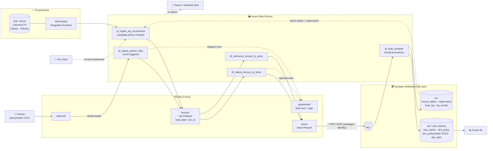
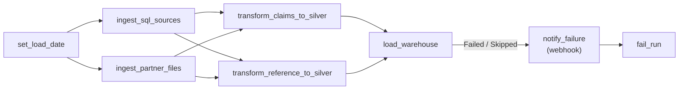
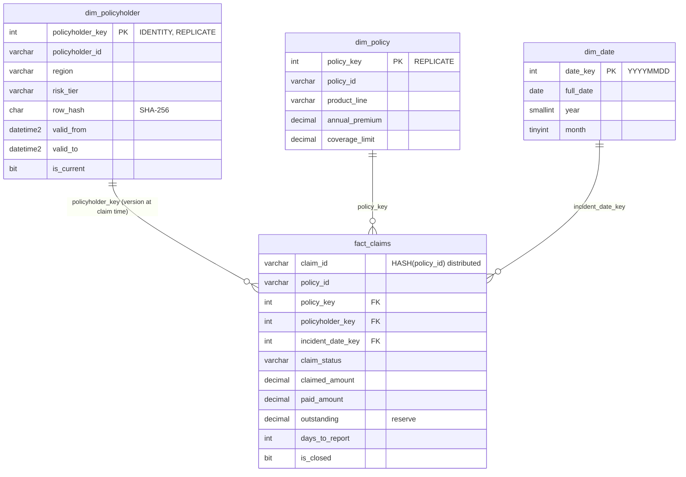

<div align="center">

# Claims Analytics Platform on Azure

### Azure Data Factory · ADLS Gen2 · Mapping Data Flows · Synapse Analytics · Bicep

A metadata-driven, incremental data platform that moves insurance claims from an on-premises SQL Server and partner file drops into a Synapse star schema for Power BI.


**Built by [Aitomation](https://aitomation.com)** · Data Engineering · Cloud · Automation

</div>

---

## Table of contents

- [The business problem](#the-business-problem)
- [Architecture](#architecture)
- [Orchestration](#orchestration)
- [Pipelines in detail](#pipelines-in-detail)
- [Synapse data model](#synapse-data-model)
- [Data quality & reliability](#data-quality--reliability)
- [Security](#security)
- [Quick start](#quick-start)
- [Project structure](#project-structure)
- [Testing & CI/CD](#testing--cicd)
- [About Aitomation](#about-aitomation)

---

## The business problem

An insurer's claims system runs on an **on-premises SQL Server**. Policyholder details come from a **distribution partner** as daily CSV files. Finance and claims managers wanted three things:

- **Loss ratio** by product line, daily rather than at month-end
- An **ageing worklist** of open claims with outstanding reserves
- Regional claim trends that stay correct **after customers move**

Hard constraints: no direct access from the cloud into the corporate network except through a gateway, no credentials in code, and an easy way to onboard more source tables later.

## Architecture



## Orchestration

`pl_master_daily` runs at **02:00 UK time**. Both ingests run in parallel, then both data flows run in parallel, then the warehouse load runs. Any failure anywhere raises an alert and marks the run as failed.



> Attaching the alert to `load_warehouse` on **Failed or Skipped** is deliberate. If *any* upstream activity fails, the load is skipped, so one handler covers the whole pipeline.

## Pipelines in detail

| Pipeline / flow | What it does | Key techniques |
|---|---|---|
| [`pl_ingest_sql_incremental`](adf/pipeline/pl_ingest_sql_incremental.json) | Reads `ctl.source_tables`, then for each active table: looks up the new high-water mark, copies only rows with `old < ModifiedAt <= new` to `bronze/<table>/load_date=…/run_id=…/`, and advances the watermark | **Metadata-driven**: onboarding a table is one `INSERT`. Runs in parallel (`batchCount 4`). The upper bound is captured *before* the copy, so no rows are missed. The watermark only moves after a successful copy |
| [`pl_ingest_partner_files`](adf/pipeline/pl_ingest_partner_files.json) | GetMetadata → Filter `*.csv` → parallel ForEach: copy to bronze Parquet, then delete the inbound file | Malformed rows are **skipped and logged to `quarantine/`** instead of failing the run. Fired by a Storage Event trigger as files arrive |
| [`df_claims_bronze_to_silver`](adf/dataflow/df_claims_bronze_to_silver.json) | Standardises claims and evaluates **all** validation rules per row (missing ids, invalid dates, paid > claimed, reported before incident, unknown status). Splits valid from rejected, keeps the latest version per claim, derives `days_to_report` | Mapping Data Flow: `derive` → `split` → `window(rowNumber)` → `filter` → Parquet sink, with rejects going to JSON in quarantine |
| [`df_reference_bronze_to_silver`](adf/dataflow/df_reference_bronze_to_silver.json) | Cleans policies, takes the latest version per policyholder and computes a **SHA-256 change hash** for SCD2 | Schema-drift tolerant (`byName`) |
| [`pl_load_synapse`](adf/pipeline/pl_load_synapse.json) | Stage → dim_policy (SCD1) → dim_policyholder (SCD2) → fact_claims (MERGE) → data quality gate | Every step is a version-controlled stored procedure |

## Synapse data model



**Distribution strategy.** Small dimensions are `REPLICATE`d, so joins need no data movement. `fact_claims` is `HASH(policy_id)` with a clustered columnstore. Staging tables are round-robin heaps for the fastest `COPY INTO`.

Analytics queries ready for Power BI: [loss ratio by product](synapse/sql/analytics/loss_ratio_by_product.sql), [open claims ageing](synapse/sql/analytics/open_claims_aging.sql), and [claims by region at the time of the claim](synapse/sql/analytics/claims_by_region_point_in_time.sql) (SCD2).

## Data quality & reliability

| Layer | Mechanism |
|---|---|
| File ingest | Copy-activity fault tolerance skips incompatible rows and logs them to `quarantine/partner_files/` |
| Bronze → silver | Seven rules per claim. Every failed rule is recorded in `reject_reason`, and rejected rows are written to `quarantine/claims/` |
| Warehouse | [`ctl.usp_run_quality_checks`](synapse/sql/procedures/ctl.usp_run_quality_checks.sql) checks for duplicate claims, paid > claimed, negative reserves, multiple current SCD2 rows, and orphaned claims. Any failed `error` check **throws**, so the ADF activity fails and the alert fires |
| Atomicity | The SCD2 procedure runs in `BEGIN TRAN … COMMIT` with `TRY/CATCH` rollback |
| Idempotency | Watermarks advance only after success. `MERGE` updates a claim only when `modified_at` is newer, so re-running a load date is safe |
| Retries | Every activity has `retry: 2` with a 60 s interval |
| Observability | ADF diagnostics go to Log Analytics (pipeline, activity and trigger runs). `ctl.load_log` and `ctl.dq_results` are queryable from Power BI |

## Security

- **Zero stored credentials.** ADF and Synapse use **system-assigned managed identities** with RBAC to the lake. The storage account has **shared-key access disabled**.
- The only secret, the on-prem SQL password, lives in **Key Vault** (RBAC mode). ADF reads it with *Secrets User* only. The validator **fails CI** if any linked service holds a plain-text password or key.
- The Synapse admin password is a `@secure()` Bicep parameter, passed at deploy time from GitHub secrets.
- CI deploys to Azure with **OIDC federation**, so no long-lived client secret exists.
- TLS 1.2 minimum, public blob access off, soft delete on blobs and containers.

## Quick start

```bash
pip install -e ".[dev]"
python scripts/generate_sample_data.py    # synthetic source extracts + partner file
python scripts/validate_adf.py            # static checks on every ADF artifact
pytest                                    # 24 tests: ADF structure + T-SQL grammar
```

Deploy to Azure:

```bash
az login
make deploy-infra RG=rg-claims-dev                 # Bicep: lake, ADF, Synapse, Key Vault, RBAC
az keyvault secret set --vault-name <kv> -n onprem-sql-password --value <pwd>
make deploy-sql                                    # schemas, tables, procedures, dim_date seed
# Connect ADF to this repo (Git integration → root folder /adf) and publish
# Install the self-hosted IR agent on a VM that can reach SQL Server
# Upload data/partner_inbound/*.csv to the inbound/partner/ container
```

## Project structure

```text
azure-data-factory-synapse-pipeline/
├── infra/bicep/
│   ├── main.bicep                  # Log Analytics, Key Vault, RBAC, module wiring
│   └── modules/                    # storage (ADLS Gen2), datafactory, synapse
├── adf/                            # ADF Git-integration layout
│   ├── pipeline/                   # master, incremental SQL, partner files, Synapse load
│   ├── dataflow/                   # bronze → silver mapping data flows
│   ├── dataset/ · linkedService/ · integrationRuntime/ · trigger/ · factory/
├── synapse/sql/
│   ├── 01_schemas_and_control.sql  # ctl / stg / dw + metadata tables
│   ├── 02_staging_and_warehouse.sql
│   ├── 03_seed_dim_date.sql
│   ├── procedures/                 # stage, SCD1, SCD2, MERGE fact, DQ gate, watermark
│   └── analytics/                  # Power BI-ready queries
├── scripts/
│   ├── validate_adf.py             # static ADF validator (used by tests + CI)
│   └── generate_sample_data.py
├── data/                           # synthetic source extracts + partner drop
├── tests/
└── .github/workflows/ci.yml        # validate → (manual) what-if + deploy via OIDC
```

## Testing & CI/CD

| Check | What it catches |
|---|---|
| [`validate_adf.py`](scripts/validate_adf.py) | Unresolved datasets, linked services, pipelines and data flows. Unknown `dependsOn` targets and dependency cycles. Unknown pipeline or trigger parameters. Data flow nodes missing from the script. Plain-text secrets |
| [`test_adf_artifacts.py`](tests/test_adf_artifacts.py) | Asserts the design decisions: parallel ingest, alert on Failed/Skipped, watermark updated only after copy, quarantine enabled, Key Vault password. Also proves the validator catches injected mistakes |
| [`test_synapse_sql.py`](tests/test_synapse_sql.py) | Every `.sql` file parses with the T-SQL grammar |
| `az bicep build` / `lint` | Template compiles. Best-practice linter rules pass |

The GitHub Actions workflow runs all checks on every push. A manual `workflow_dispatch` with `deploy: true` runs `what-if` and then deploys through OIDC.

---

## About Aitomation

**Aitomation** builds data platforms and automation for growing businesses: ETL/ELT pipelines, cloud data warehouses, orchestration, real-time streaming and analytics.

| # | Project | Stack |
|---|---|---|
| 1 | End-to-End ETL Data Pipeline | Python · SQL · PostgreSQL |
| 2 | Cloud Data Engineering on AWS | S3 · Glue · Lambda · Redshift |
| 3 | **Cloud Data Engineering on Azure** *(this repo)* | Data Factory · Synapse Analytics |
| 4 | Big Data Processing Pipeline | Databricks · PySpark |
| 5 | Modern Data Warehouse & ELT | Snowflake · dbt |
| 6 | Automated Pipeline Orchestration | Apache Airflow |
| 7 | Real-Time Big Data Pipeline | Apache Kafka · Spark Streaming |

**Need something similar?** [Get in touch at aitomation.com](https://aitomation.com).

<div align="center"><sub>Released under the <a href="LICENSE">MIT License</a> · © 2026 Aitomation</sub></div>
